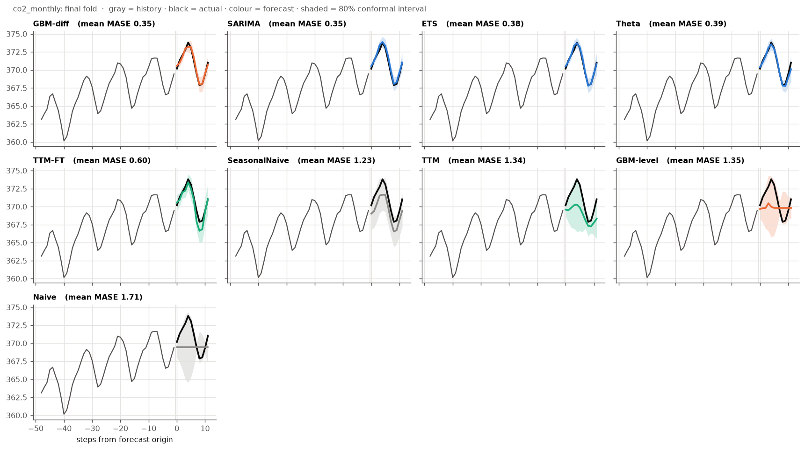
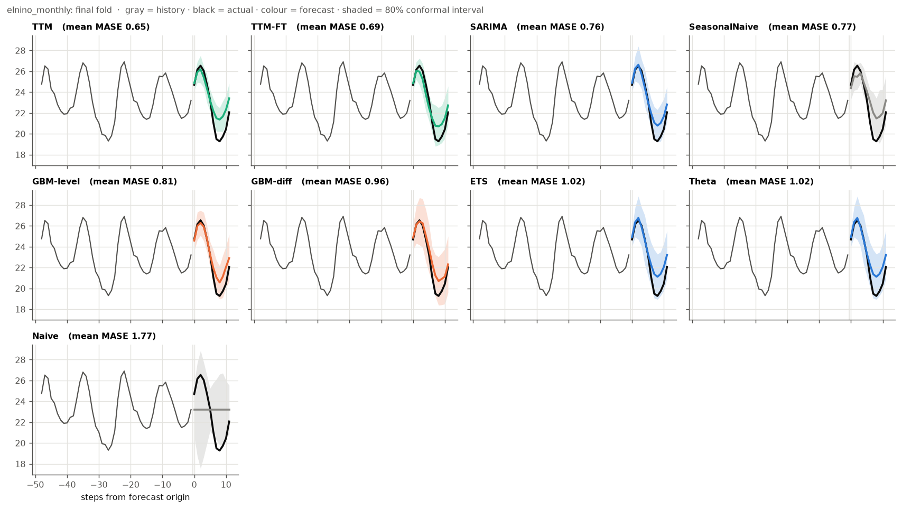
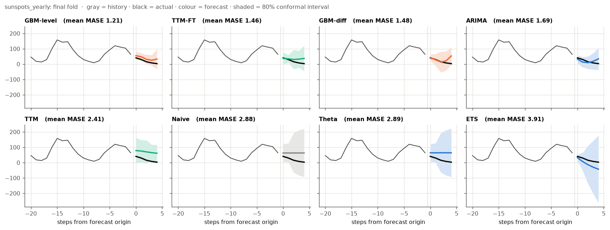
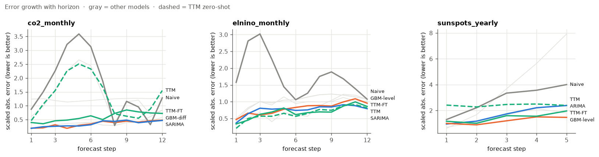
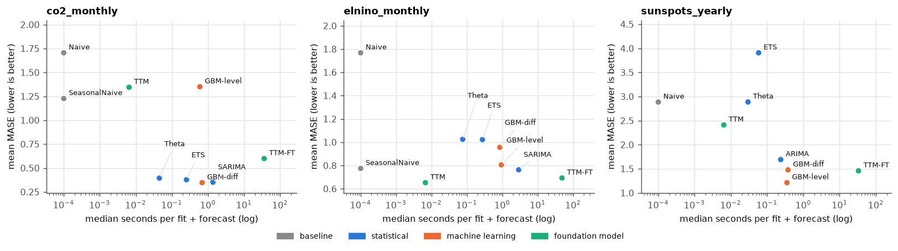
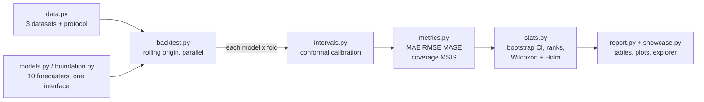

<div align="center">

# tsbench

### Which forecasting model wins, and can you trust the answer?

A reproducible benchmark that pits classical statistics, gradient boosting and
**IBM's Granite TinyTimeMixer** foundation model against each other on real data,
and checks whether the winner *really* won.

Built by **Krishna** ([@Krishna-cpp](https://github.com/Krishna-cpp)).

[](https://github.com/Krishna-cpp/ts-benchmark/actions/workflows/ci.yml)


**[▶ Try the interactive Forecast Explorer](https://Krishna-cpp.github.io/ts-benchmark/)**
 · [Open the walkthrough in Colab](https://colab.research.google.com/github/Krishna-cpp/ts-benchmark/blob/main/notebooks/walkthrough.ipynb)
 · [Full results](results/RESULTS.md)

</div>


## TL;DR

* **There is no best model, only a best model *for a kind of data*.** Gradient boosting won on
  rising CO₂, IBM's pretrained TTM won on El Niño sea temperatures, and a different gradient
  boosting variant won on sunspots.
* **One line of code turns a failing model into a winner.** A tree model can't predict values
  above anything it saw in training, so on a rising series it flatlines (picture above). Training
  it on month-to-month *changes* instead cuts its error by 74%.
* **IBM Granite TTM is strong out of the box and fine-tuning is not always better.** Zero-shot it
  is the most accurate model on El Niño and runs in milliseconds. Fine-tuning on each training
  window cuts its error by 40–55% on CO₂ and sunspots, but slightly *hurts* on El Niño.
* **Most "wins" are not statistically significant.** With 10–12 test periods per dataset, the top
  3–8 models are usually tied. This benchmark reports that instead of hiding it.

## The question

Forecasting leaderboards usually show one number per model and crown the lowest. That hides
three problems this project tackles head-on:

| Problem | What tsbench does |
|---|---|
| A single train/test split is one roll of the dice | **Rolling-origin backtesting**: refit and test at 10–12 points in time |
| A forecast without uncertainty is hard to act on | **Conformal prediction intervals** for *every* model, checked for calibration |
| Small gaps between models may be pure noise | **Paired significance tests** (Wilcoxon + Holm correction) and bootstrap CIs |

### How the backtest works

The model only ever sees the past (blue). It forecasts the next 12 months, gets scored against
what actually happened, then the window moves forward and it all repeats.

<p align="center"></p>

## Results

Mean MASE across folds (lower is better; below 1 roughly means "better than a naive one-step
forecast"). **Bold** = best on that dataset. † = significantly worse than the best (5% level).
Unmarked models are statistically tied with the best.

| Model | Type | CO₂ (trend + season) | El Niño (season, no trend) | Sunspots (noisy cycle) |
|---|---|---|---|---|
| Naive | baseline | 1.71 † | 1.77 † | 2.89 † |
| Seasonal Naive | baseline | 1.23 † | 0.77 | n/a |
| ETS (damped) | statistics | 0.38 | 1.02 | 3.91 † |
| Theta | statistics | 0.39 | 1.02 | 2.89 † |
| (S)ARIMA | statistics | 0.35 | 0.76 | 1.69 † |
| GBM on levels | machine learning | 1.35 † | 0.81 | **1.21** |
| GBM on changes | machine learning | **0.35** | 0.96 | 1.48 |
| Granite TTM, zero-shot | foundation model | 1.34 † | **0.65** | 2.41 † |
| Granite TTM, fine-tuned | foundation model | 0.60 † | 0.69 | 1.46 |


<details>
<summary><b>More charts:</b> forecasts with intervals, error vs. horizon, accuracy vs. compute</summary>






</details>

## What I learned

1. **Match the model to the structure of the data.** Trend + stable seasonality (CO₂) is
   classical-statistics territory: SARIMA, ETS, Theta and differenced GBM are tied, and none of
   the fancier options beats them. Irregular swings (El Niño) favour the pretrained model.
   Noisy cycles (sunspots) favour flexible lag-based ML.
2. **Trees can't extrapolate, so give them a stationary target.** GBM on levels vs. GBM on
   changes differ in exactly one line and the error drops from 1.35 to 0.35. A unit test pins
   this behaviour (`test_gbm_level_cannot_extrapolate_but_gbm_diff_can`).
3. **Fine-tuning a foundation model is a trade-off, not an upgrade.** Fine-tuned TTM improved a lot
   where zero-shot was weak (CO₂ 1.34 → 0.60, sunspots 2.41 → 1.46) but slipped where zero-shot
   was already best (El Niño 0.65 → 0.69), and it costs ~35–50 s per fit versus ~5 ms zero-shot.
4. **Calibrated uncertainty is achievable for any model.** Conformal intervals targeting 80% hit
   81.7% overall (75–88% per model). SARIMA and zero-shot TTM under-cover most, because
   time-series errors are not exchangeable, the one assumption conformal prediction relies on.
5. **Always keep a naive baseline.** Damped-trend ETS on sunspots is *worse than repeating the last
   value*. Without the baseline, that failure would be invisible.

### A bug worth knowing about (IBM Granite TTM)

TTM expects a 512-step history. Shorter histories must be padded, and the library's "zeropad"
mode assumes standardised data. Padding raw CO₂ values (~355 ppm) with zeros looked harmless,
but TTM standardises internally, so the zeros became extreme outliers and one forecast scored a
MASE of **11.5** instead of ~1.0. The fix: pad with the window's mean (which standardises to
exactly 0) and mask it out. A regression test shifts a series by a constant and checks the
forecast shifts by the same constant. I also chose the TTM variant from the documentation
(`512-96-r2`, which has no frequency token, since monthly/yearly data is outside the token
vocabulary) **before** looking at any test scores, so the comparison is not tuned on the test set.

## Run it yourself

```bash
python -m venv .venv
.venv\Scripts\activate            # Windows   |   source .venv/bin/activate  (macOS/Linux)
pip install -e ".[dev]"

python -m tsbench --quick          # 1-minute smoke run
python -m tsbench                  # full benchmark, classical models (~2-3 min on 12 cores)
python -m tsbench.showcase         # rebuild the explorer, GIF and hero image in docs/
pytest                             # 47 tests
```

Add IBM Granite TTM (CPU is fine):

```bash
pip install torch --index-url https://download.pytorch.org/whl/cpu
pip install -e ".[foundation]"
python -m tsbench --with-ttm       # zero-shot + fine-tuned TTM (~40 min on 12 cores; fine-tuning dominates)
```

Or with Docker: `docker build -t tsbench . && docker run --rm -v "$(pwd)/results:/app/results" tsbench`.

Handy options: `--datasets co2_monthly`, `--models Naive SARIMA TTM`, `--no-intervals` (≈10x faster),
`--alpha 0.05` (95% intervals), `--jobs 4`, `--list`.

<details>
<summary><b>Technical details:</b> methodology, datasets, models, metrics, project layout</summary>

### Methodology



* **Rolling origin.** Origins step forward by one horizon; the last fold ends at the end of the
  series. Every (model, fold) pair is independent and runs in parallel with `joblib`. A model
  that crashes on one fold is logged and recorded, not allowed to kill the run.
* **Conformal intervals.** Inside each fold's training data the model is backtested 10 more
  times; the absolute errors at each horizon step give the half-width via the finite-sample
  conformal quantile (`ceil((n+1)(1-α))`-th smallest). Intervals widen with the horizon and
  never see the future.
* **Statistics.** Folds are paired, so each model is compared with the best by a paired
  Wilcoxon signed-rank test with Holm correction, plus a 95% bootstrap CI and mean rank. With
  10 folds and 8 comparisons the smallest attainable adjusted p-value is ≈0.016.
* **No look-ahead, enforced by tests.** Every model, and the interval calibration, is checked
  by changing data *after* the origin and asserting the forecast does not change.

### Datasets (bundled with `statsmodels`, so everything runs offline)

| Dataset | n | Frequency | Structure | Horizon | Folds |
|---|---|---|---|---|---|
| `co2_monthly` | 526 | monthly | strong trend + stable yearly seasonality | 12 | 10 |
| `elnino_monthly` | 732 | monthly | yearly seasonality, no trend, irregular ENSO swings | 12 | 10 |
| `sunspots_yearly` | 309 | yearly | noisy ~11-year cycle of varying length | 5 | 12 |

### Models

| Model | Idea |
|---|---|
| Naive / Seasonal Naive | repeat the last value / the last seasonal cycle |
| ETS | Holt-Winters exponential smoothing, damped additive trend |
| Theta | M3-competition winner: exponential smoothing with drift on deseasonalised data |
| (S)ARIMA | fixed orders per dataset, chosen once, not tuned per fold |
| GBM on levels / changes | gradient boosting on 22–24 lags, recursive multi-step forecasts |
| Granite TTM | [IBM's ~1M-parameter pretrained model](https://huggingface.co/ibm-granite/granite-timeseries-ttm-r2), zero-shot |
| Granite TTM fine-tuned | backbone frozen, decoder + head (~290k params) trained on each training window only, 10 epochs, lr 1e-3, fixed in advance |

### Metrics

MAE and RMSE in data units; **MASE** (MAE ÷ in-sample MAE of a seasonal-naive forecast) for
comparisons across datasets; interval **coverage** and **MSIS** (the M4 competition's interval
score: width plus 2/α times every miss).

### Outputs (`results/`, all generated, never edited by hand)

`RESULTS.md` (full tables) · `summary.csv` · `fold_results.csv` (incl. errors) · `forecasts.csv`
(every forecast and interval) · `run_metadata.json` (config + package versions) · figures.
`docs/` holds the explorer (`index.html`), hero image, GIF and social card.

### Project layout

```
tsbench/
  data.py          datasets + evaluation protocol
  models.py        Forecaster interface, baselines, ETS, Theta, SARIMA, GBM, registry
  foundation.py    IBM Granite TTM: zero-shot and per-fold fine-tuning
  backtest.py      rolling-origin evaluation, parallel, fault-tolerant
  intervals.py     conformal prediction intervals
  metrics.py       MAE, RMSE, MASE, coverage, MSIS
  stats.py         bootstrap CIs, ranks, Wilcoxon + Holm
  report.py        figures, RESULTS.md, run metadata
  showcase.py      hero image, GIF, social card, interactive explorer
  cli.py           python -m tsbench
tests/             47 tests (leakage, metrics, intervals, stats, end-to-end, TTM)
notebooks/         Colab walkthrough
```

### Limitations

* Hyperparameters and ARIMA orders are fixed, not tuned per fold.
* Three series with 10–12 folds each, so many differences are not significant (and are reported as such).
* Conformal coverage is measured, not guaranteed, because time-series errors are autocorrelated.
* Runtimes are from one 12-core machine running models in parallel; compare them relative to each other.

</details>

## Roadmap

- [x] Zero-shot and fine-tuned IBM Granite TTM
- [x] Conformal intervals + significance tests
- [x] Interactive explorer
- [ ] Amazon Chronos and Google TimesFM behind the same interface
- [ ] A business dataset (electricity demand or retail sales)
- [ ] Scale to 100+ series from the M4 competition
- [ ] Adaptive conformal inference to fix under-coverage

## Author

**Krishna**, [github.com/Krishna-cpp](https://github.com/Krishna-cpp)

## License

MIT © 2026 Krishna, see [LICENSE](LICENSE).
