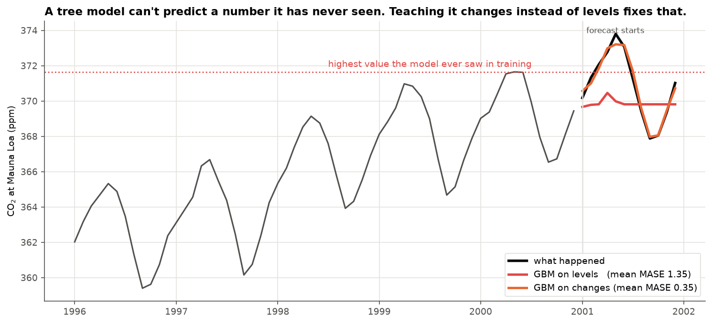
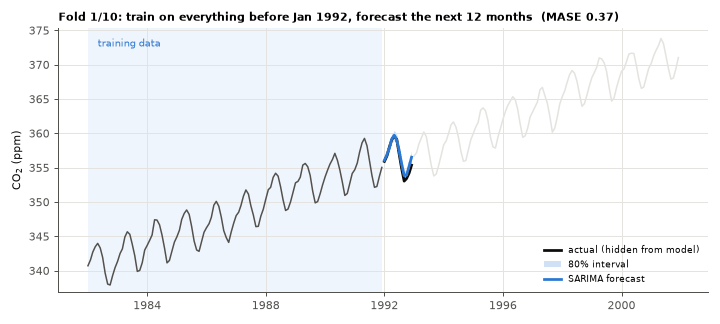
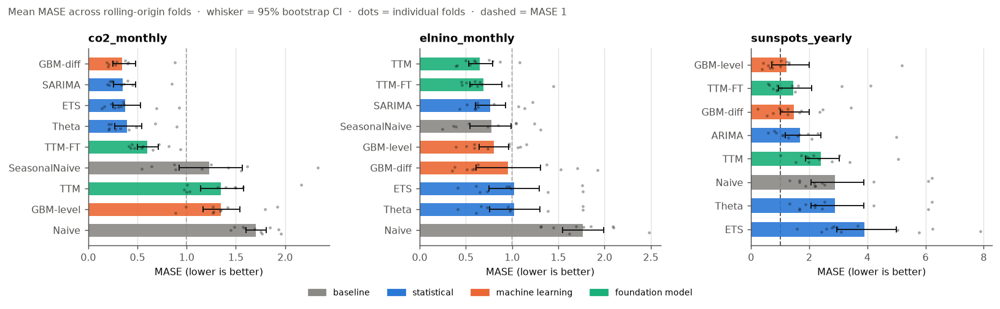
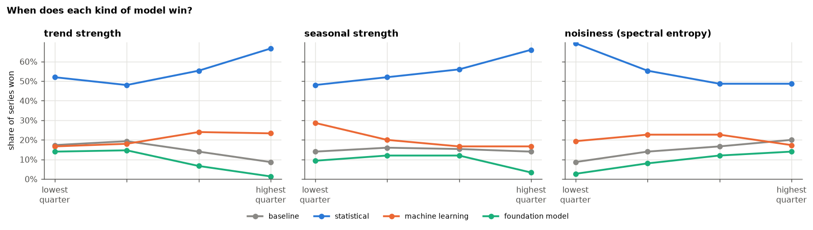

# ts-benchmark

[](https://github.com/Krishna-cpp/ts-benchmark/actions/workflows/ci.yml)

I wanted to know how much the choice of forecasting model actually matters, and whether the
differences you see on a leaderboard are real or just noise. So I put nine models through the
same test on three real time series: simple baselines, classical statistics (ETS, Theta,
SARIMA), gradient boosting, and IBM's pretrained Granite TinyTimeMixer, both out of the box and
fine-tuned. Then I scaled it up to 600 business series and trained a recommender that suggests
which models to use for a new series.

You can step through every forecast in the [interactive explorer](https://krishna-cpp.github.io/ts-benchmark/),
or run a short version of the benchmark yourself in the
[Colab notebook](https://colab.research.google.com/github/Krishna-cpp/ts-benchmark/blob/main/notebooks/walkthrough.ipynb).



The picture above is my favourite result. Both lines come from the same gradient boosting
model. The red one was trained on CO₂ levels and can never predict a value higher than
anything it saw in training, so it flatlines. The orange one was trained on month-to-month
changes and follows the real curve. That one-line difference takes the average error
from 1.35 to 0.35.

## How the test works

Each model sees a series up to some date and predicts the next 12 months (5 years for
sunspots). I score that forecast against what really happened, move the date forward, refit
every model, and repeat. That gives 10 to 12 forecasts per model per dataset, and none of them
could peek at the future. A test in `tests/` checks this for every model by changing the data
after the forecast date and making sure the forecast doesn't move.

<p align="center"></p>

Each forecast also comes with an 80% range. I build it the same way for every model: before
forecasting, the model is backtested ten more times on its own training data, and the spread of
those errors sets the width of the band (split conformal prediction). Then I check how often
the real values actually landed inside.

To decide whether one model really beat another, I compare them forecast by forecast with a
paired Wilcoxon test and correct for testing several models at once (Holm). With only 10 to 12
forecasts per dataset, many gaps that look big turn out to be ties.

## Results

The numbers are MASE: forecast error divided by the error of "repeat the last value" on the
training data. Lower is better. Bold marks the best model on each dataset, and † marks models
that did significantly worse than it. Everything without a † is tied with the best.

| Model | CO₂ (trend and season) | El Niño (season, no trend) | Sunspots (noisy cycle) |
|---|---|---|---|
| Naive | 1.71 † | 1.77 † | 2.89 † |
| Seasonal naive | 1.23 † | 0.77 | n/a |
| ETS (damped trend) | 0.38 | 1.02 | 3.91 † |
| Theta | 0.39 | 1.02 | 2.89 † |
| SARIMA / ARIMA | 0.35 | 0.76 | 1.69 † |
| GBM on levels | 1.35 † | 0.81 | **1.21** |
| GBM on changes | **0.35** | 0.96 | 1.48 |
| IBM TTM, zero-shot | 1.34 † | **0.65** | 2.41 † |
| IBM TTM, fine-tuned | 0.60 † | 0.69 | 1.46 |

Full tables with confidence intervals, p-values, interval coverage and runtimes are in
[results/RESULTS.md](results/RESULTS.md). That file and every chart in `results/` are written by
the benchmark itself, so they always match the code.



## What I took away from it

No model won everywhere. On CO₂, which has a steady trend and a regular yearly cycle, the
classical models and the differenced GBM were all tied at the top and nothing fancier beat them.
On El Niño, where the swings are irregular, IBM's pretrained model did best without any
training on the data. On sunspots, a flexible lag-based GBM won.

Fine-tuning IBM's model was a trade-off. It helped a lot where the zero-shot model struggled
(CO₂ went from 1.34 to 0.60, sunspots from 2.41 to 1.46) and slightly hurt where it was already
the best (El Niño went from 0.65 to 0.69). It is also far slower: around 35 to 50 seconds per
fit, against a few milliseconds for zero-shot.

The 80% ranges were close to honest. Across all models, 81.7% of real values fell inside them.
SARIMA (75%) and zero-shot TTM (78%) were the most overconfident.

Keeping the naive baseline paid off. ETS with a damped trend did worse than simply repeating the
last value on sunspots, and I wouldn't have noticed without it.

## Picking a model automatically

Three datasets can only show so much, so I ran the same kind of test on 600 series from the
[M4 forecasting competition](https://github.com/Mcompetitions/M4-methods): monthly, quarterly and
yearly data from finance, industry, macro-economics, demographics and more, with five forecasts
per series.

For each series I compute ten simple numbers from its history, such as how strong the trend and
the yearly pattern are and how noisy it is. A random forest learns from those numbers how well
each model is likely to do on that series. To keep the scores honest I trained it on four fifths
of the series and tested it on the remaining fifth, five times over, so every number below comes
from series it had never seen.

| Strategy, 600 series | Mean MASE | Median MASE |
|---|---|---|
| Oracle (knows the winner in advance, impossible in practice) | 1.62 | 1.04 |
| Recommender, average of its top 3 models | **1.82** | **1.20** |
| Plain average of ETS, ARIMA, Theta and GBM on changes | 1.84 | 1.21 |
| Recommender, its single top model | 1.85 | 1.21 |
| Always ARIMA (the best single model) | 1.88 | 1.25 |
| Always ETS | 1.92 | 1.24 |
| Always IBM TTM, zero-shot | 3.73 | 1.80 |

Averaging the recommender's top three cut the typical error by 3.5% compared with always using
ARIMA, and did better on 63% of the series (paired Wilcoxon test, p < 0.001). Most of that gain
comes from averaging itself, though. Against a plain average of four good models, the
recommender's choice was only 1.3% better, which is not statistically significant (p = 0.056).
So my honest summary is: averaging several decent models is the biggest win, and choosing which
ones to average helps a little on top.

The bigger lesson was about IBM's TTM. On these business series it was one of the weakest models
when used without fine-tuning. It held up on monthly data (mean MASE 1.33 against 1.01 for ETS)
but fell apart on yearly data (7.27 against 3.56), and its worst failures were short series with a
strong trend, where it flattens out instead of following the trend. It won 14% of the series with
the weakest trends and almost none of those with the strongest.



You can ask the trained recommender about your own data. The CSV needs one numeric column, oldest
value first. Here it is on the CO₂ series, which was not part of its training data:

```
$ python -m tsbench.suggest co2.csv --season 12
526 values. Trend strength 1.00, seasonal strength 0.98, noisiness 0.34.

Predicted error (MASE) per model, best first:
  1. ARIMA           0.80   (S)ARIMA  <- use
  2. ETS             0.82   exponential smoothing  <- use
  3. Theta           0.94   Theta method  <- use
  4. GBM-diff        1.05   gradient boosting on changes
  5. SeasonalNaive   1.23   repeat the last season
  6. GBM-level       1.44   gradient boosting on levels
  7. Naive           1.80   repeat the last value
  8. TTM             1.90   IBM Granite TTM, zero-shot

Suggestion: average the forecasts of ARIMA, ETS, Theta.
```

That matches what the full benchmark found on CO₂. The complete study, with per-frequency tables
and the significance tests, is in [results/recommender/REPORT.md](results/recommender/REPORT.md).

## A bug I ran into with IBM TTM

TTM expects 512 past values, so shorter histories have to be padded. I first padded with zeros.
The model rescales its input internally, and next to CO₂ readings around 355 ppm those zeros
became huge outliers. One forecast came out with a MASE of 11.5 instead of about 1. Padding with
the mean of the real values instead (which rescales to exactly zero) and masking the padding
fixed it. There is now a test that shifts a series up by a constant and checks that the
forecast shifts by the same amount.

I also picked which TTM variant to use (`512-96-r2`) from IBM's documentation before looking at
any results. The shorter variants rely on a frequency code that only covers minute-to-weekly
data, which doesn't fit monthly or yearly series.

## Running it

You need Python 3.10 or newer.

```bash
python -m venv .venv
.venv\Scripts\activate          # on macOS or Linux: source .venv/bin/activate
pip install -e ".[dev]"

python -m tsbench --quick        # about a minute, 3 forecasts per dataset
python -m tsbench                # the full run without IBM TTM, a few minutes
pytest                           # 51 tests
```

To include IBM TTM (a CPU is enough):

```bash
pip install torch --index-url https://download.pytorch.org/whl/cpu
pip install -e ".[foundation]"
python -m tsbench --with-ttm     # about 40 minutes on 12 cores, mostly fine-tuning
```

To rerun the 600-series study behind the recommender (downloads about 170 MB of M4 data once):

```bash
python -m tsbench.m4 --download
python -m tsbench.recommender    # about 7 minutes on 12 cores
```

`python -m tsbench --help` lists the other options, such as picking datasets or models,
switching off the intervals, or changing the interval level. After a run,
`python -m tsbench.showcase` rebuilds the explorer and the images in `docs/`. There is also a
`Dockerfile` if you'd rather not set up Python.

## Data and models

All three datasets ship with `statsmodels`, so nothing needs downloading.

- **CO₂ at Mauna Loa**, monthly, 526 points. Strong upward trend plus a yearly cycle.
- **El Niño sea temperature**, monthly, 732 points. Yearly cycle, no trend, irregular multi-year swings.
- **Sunspots**, yearly, 309 points. A noisy cycle of roughly 11 years whose length keeps changing.

The models are Naive and Seasonal naive (repeat the last value or the last year), ETS, Theta,
SARIMA with fixed orders per dataset, gradient boosting on the previous 22 to 24 values (once on
levels and once on changes), and IBM's [Granite TinyTimeMixer](https://huggingface.co/ibm-granite/granite-timeseries-ttm-r2).
For the fine-tuned TTM I froze the pretrained backbone and trained only the last layers on each
forecast's own training data, with settings fixed before the first run.

## Code layout

```
tsbench/
  data.py         datasets and forecast settings
  models.py       baselines, ETS, Theta, SARIMA, gradient boosting
  foundation.py   IBM TTM, zero-shot and fine-tuned
  backtest.py     the rolling forecast loop (runs in parallel)
  intervals.py    the 80% ranges
  metrics.py      MAE, RMSE, MASE, coverage, interval score
  stats.py        confidence intervals and significance tests
  report.py       charts and RESULTS.md
  showcase.py     the explorer page, GIF and images in docs/
  m4.py           loads a fixed sample of M4 competition series
  features.py     the ten numbers that describe a series
  recommender.py  the 600-series study and the model recommender
  suggest.py      python -m tsbench.suggest, for your own CSV
  cli.py          python -m tsbench
models/           the trained recommender
tests/            51 tests
notebooks/        the Colab walkthrough
```

## What it doesn't do (yet)

The model settings are fixed rather than tuned for each forecast, so a tuned SARIMA or ETS might
do better. The fine-tuned TTM is too slow to include in the 600-series study, so the recommender
only knows zero-shot TTM. The recommender was trained on M4 series, so it may be less reliable on
data that looks very different, such as hourly sensor readings. Next I'd like to add Amazon's
Chronos and Google's TimesFM for comparison and try fine-tuning TTM only on the series where the
recommender expects it to help.

## License

MIT. Made by Krishna ([@Krishna-cpp](https://github.com/Krishna-cpp)).
