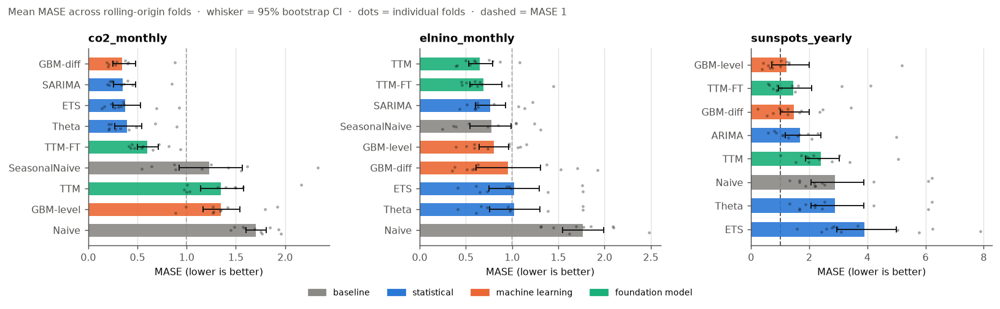
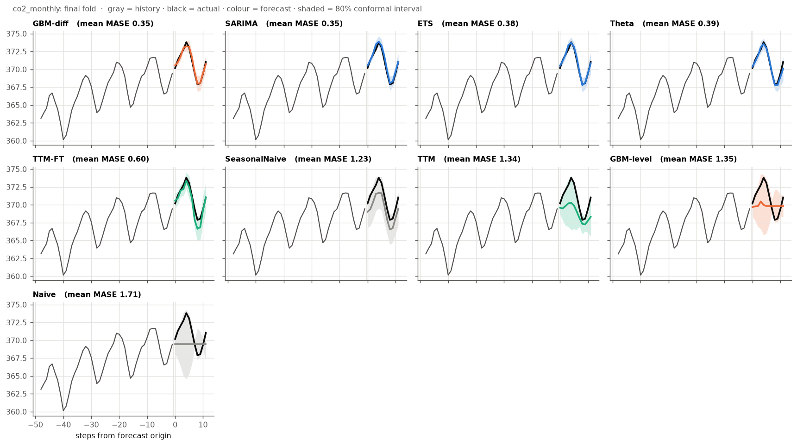
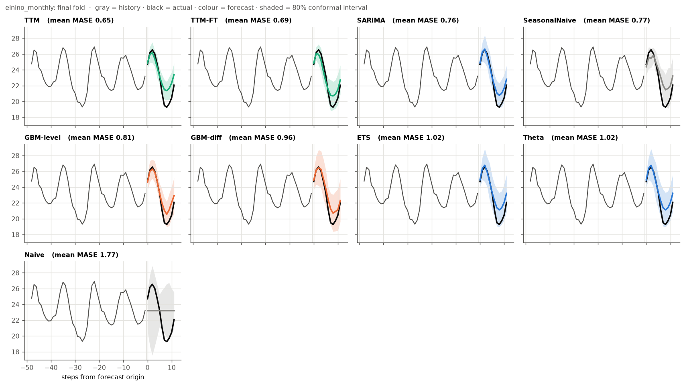
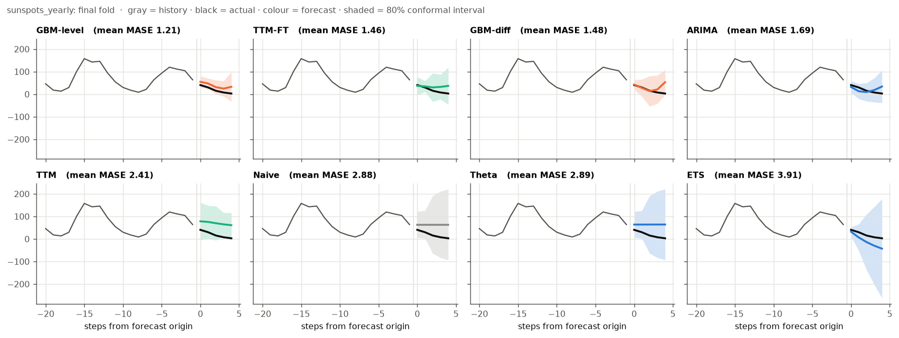
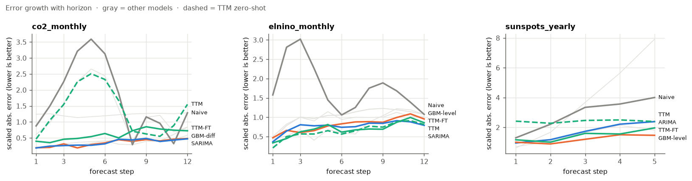
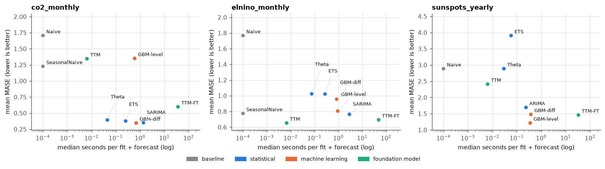

# Benchmark results

_Generated by `python -m tsbench` on 2026-11-08 09:18 UTC in 2433s. Do not edit by hand._

* **MASE**: mean over folds; 95% bootstrap CI in brackets. Lower is better.
* **rank**: mean rank across folds (1 = best in every fold).
* **p vs best**: paired Wilcoxon signed-rank test against the best model, Holm-corrected. **Bold** = significantly worse at the 5% level.

* **cov80**: empirical coverage of the 80% conformal interval (target 0.80). **MSIS**: scaled interval score, lower is better.

## co2_monthly

Mauna Loa CO2: strong trend + stable yearly seasonality. 526 observations, horizon 12, 10 folds.

| Model | MASE (95% CI) | rank | p vs best | MAE | cov80 | MSIS | sec/fit |
|---|---|---|---|---|---|---|---|
| **GBM-diff** | 0.35 (0.25–0.48) | 2.1 | best | 0.432 | 0.85 | 1.78 | 0.689 |
| SARIMA | 0.35 (0.26–0.48) | 2.7 | 1.000 | 0.438 | 0.78 | 1.60 | 1.375 |
| ETS | 0.38 (0.25–0.53) | 2.6 | 0.967 | 0.468 | 0.82 | 1.77 | 0.254 |
| Theta | 0.39 (0.27–0.54) | 2.9 | 0.967 | 0.489 | 0.88 | 1.89 | 0.045 |
| TTM-FT | 0.60 (0.50–0.71) | 4.8 | **0.016** | 0.749 | 0.77 | 2.77 | 36.284 |
| SeasonalNaive | 1.23 (0.93–1.56) | 6.7 | **0.016** | 1.5 | 0.82 | 4.38 | 0.000 |
| TTM | 1.34 (1.14–1.58) | 7.5 | **0.016** | 1.7 | 0.73 | 4.17 | 0.006 |
| GBM-level | 1.35 (1.17–1.54) | 7.1 | **0.016** | 1.7 | 0.80 | 4.51 | 0.596 |
| Naive | 1.71 (1.60–1.81) | 8.6 | **0.016** | 2.1 | 0.86 | 4.51 | 0.000 |

## elnino_monthly

Pacific sea temperature: seasonality, no trend, irregular ENSO swings. 732 observations, horizon 12, 10 folds.

| Model | MASE (95% CI) | rank | p vs best | MAE | cov80 | MSIS | sec/fit |
|---|---|---|---|---|---|---|---|
| **TTM** | 0.65 (0.53–0.79) | 3.4 | best | 0.771 | 0.90 | 2.86 | 0.007 |
| TTM-FT | 0.69 (0.55–0.89) | 3.9 | 0.967 | 0.820 | 0.83 | 3.20 | 48.731 |
| SARIMA | 0.76 (0.60–0.93) | 3.9 | 0.967 | 0.902 | 0.71 | 3.04 | 2.908 |
| SeasonalNaive | 0.77 (0.55–0.99) | 3.7 | 0.967 | 0.913 | 0.95 | 4.93 | 0.000 |
| GBM-level | 0.81 (0.64–0.96) | 4.6 | 0.967 | 0.953 | 0.81 | 3.93 | 0.942 |
| GBM-diff | 0.96 (0.61–1.31) | 4.8 | 0.967 | 1.1 | 0.81 | 4.46 | 0.853 |
| ETS | 1.02 (0.75–1.30) | 5.8 | 0.137 | 1.2 | 0.86 | 4.75 | 0.275 |
| Theta | 1.02 (0.75–1.30) | 6.0 | 0.137 | 1.2 | 0.85 | 4.62 | 0.076 |
| Naive | 1.77 (1.55–1.99) | 8.9 | **0.016** | 2.1 | 0.78 | 7.05 | 0.000 |

## sunspots_yearly

Sunspots: noisy quasi-cycle of varying length, no trend. 309 observations, horizon 5, 12 folds.

| Model | MASE (95% CI) | rank | p vs best | MAE | cov80 | MSIS | sec/fit |
|---|---|---|---|---|---|---|---|
| **GBM-level** | 1.21 (0.71–2.00) | 2.0 | best | 20.9 | 0.85 | 8.65 | 0.353 |
| TTM-FT | 1.46 (0.95–2.09) | 3.0 | 0.467 | 25.4 | 0.80 | 8.84 | 33.090 |
| GBM-diff | 1.48 (1.01–2.01) | 2.8 | 0.467 | 25.7 | 0.87 | 8.09 | 0.377 |
| ARIMA | 1.69 (1.17–2.41) | 3.2 | **0.015** | 29.3 | 0.83 | 9.30 | 0.237 |
| TTM | 2.41 (1.88–3.03) | 5.5 | **0.004** | 42.2 | 0.72 | 12.00 | 0.006 |
| Naive | 2.88 (2.06–3.88) | 5.8 | **0.003** | 50.0 | 0.78 | 15.13 | 0.000 |
| Theta | 2.89 (2.06–3.88) | 6.2 | **0.003** | 50.1 | 0.78 | 15.14 | 0.030 |
| ETS | 3.91 (2.94–4.99) | 7.4 | **0.003** | 68.1 | 0.82 | 15.90 | 0.058 |

## Figures

