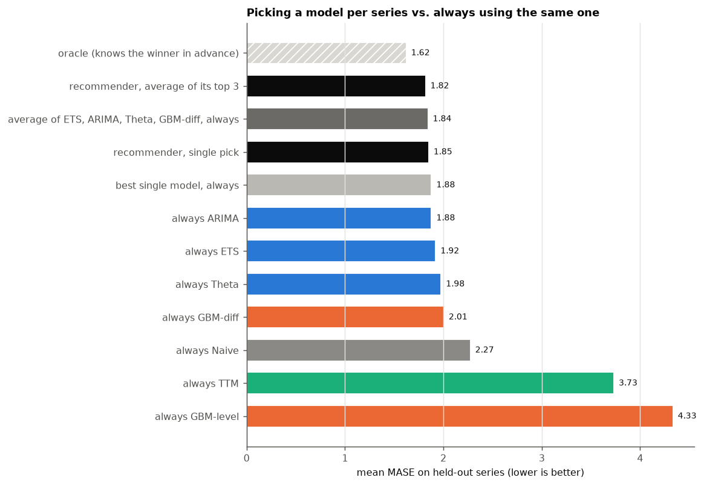
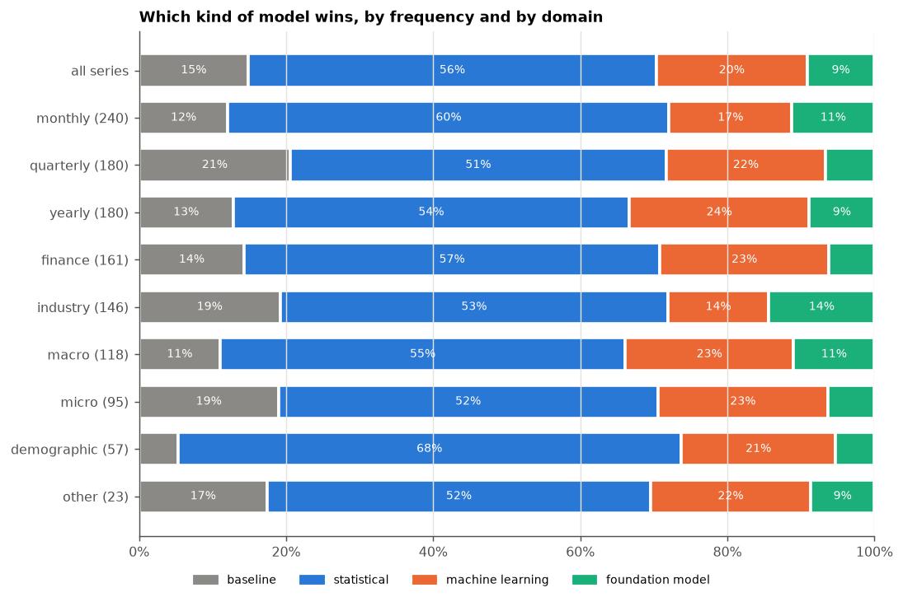
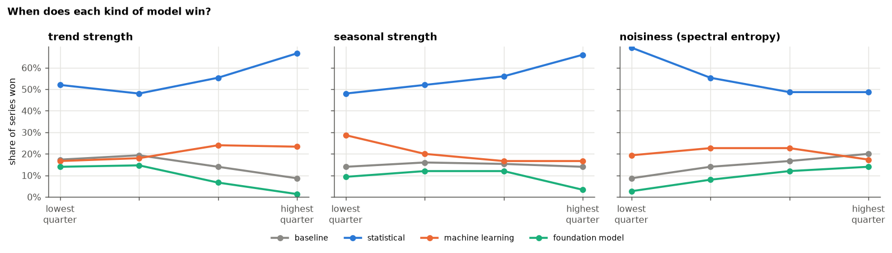
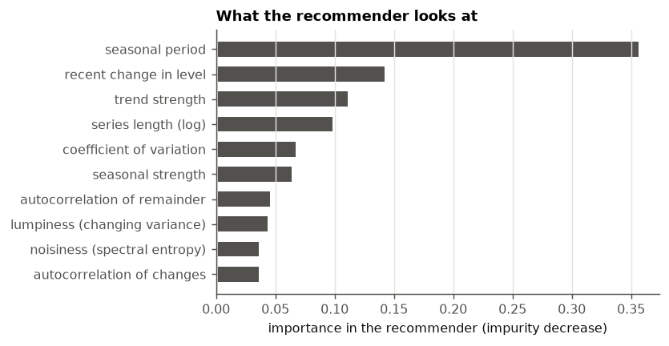

# Model recommender: results

_Generated by `python -m tsbench.recommender` on 600 M4 series, 5 rolling-origin forecasts each, in 7 minutes. Do not edit by hand._

Every number below is measured on series the recommender did not see during training (5-fold cross-validation over series).

Mean MASE is the usual competition score but a few disastrous series can dominate it, so the median and the geometric mean are shown too.

| Strategy | Mean MASE | Median | Geometric mean |
|---|---|---|---|
| oracle (knows the winner in advance) | 1.623 | 1.042 | 1.131 |
| recommender, average of its top 3 | 1.819 | 1.199 | 1.299 |
| average of ETS, ARIMA, Theta, GBM-diff, always | 1.843 | 1.208 | 1.316 |
| recommender, single pick | 1.851 | 1.214 | 1.326 |
| best single model, always | 1.880 | 1.248 | 1.345 |
| always ARIMA | 1.880 | 1.248 | 1.345 |
| always ETS | 1.922 | 1.244 | 1.350 |
| always Theta | 1.977 | 1.286 | 1.399 |
| always GBM-diff | 2.005 | 1.427 | 1.499 |
| always Naive | 2.275 | 1.485 | 1.590 |
| always TTM | 3.733 | 1.799 | 2.176 |
| always GBM-level | 4.333 | 1.896 | 2.386 |

* The recommender's pick was within 10% of the best possible model on 51% of series (always using ARIMA: 47%).
* It beat always-ARIMA on 37% of series and lost on 30% (the rest were the same pick).
* It closed 11% of the gap between always-ARIMA and the oracle.
* Averaging the recommender's top 3 beat the fixed average on 50% of series and beat always-ARIMA on 63%.

## Are the differences real?

Paired Wilcoxon signed-rank test on the log of each series' MASE ratio. "Typical change" is the geometric mean ratio: 0.97 means 3% lower error.

| Comparison | Typical change | Better on | Worse on | p-value |
|---|---|---|---|---|
| recommender (single pick) vs. best single model | 0.986 | 37% | 30% | 0.012 |
| recommender (top 3 averaged) vs. best single model | 0.965 | 63% | 37% | <0.001 |
| recommender (top 3 averaged) vs. fixed average | 0.987 | 50% | 50% | 0.056 |
| fixed average vs. best single model | 0.978 | 59% | 41% | <0.001 |

## Mean MASE by frequency

| Model | monthly | quarterly | yearly |
|---|---|---|---|
| ETS | 1.01 | 1.50 | 3.56 |
| ARIMA | 1.02 | 1.51 | 3.39 |
| Theta | 1.02 | 1.56 | 3.67 |
| GBM-diff | 1.20 | 1.59 | 3.50 |
| TTM | 1.33 | 3.40 | 7.27 |
| GBM-level | 1.34 | 2.92 | 9.74 |
| Naive | 1.34 | 1.80 | 4.00 |
| SeasonalNaive | 1.37 | 1.93 | – |



## Who wins where

Number of series each model won: ARIMA 133, Theta 101, ETS 99, GBM-diff 91, Naive 68, TTM 55, GBM-level 32, SeasonalNaive 21.





## Rules of thumb

A depth-3 decision tree over which *family* wins, with the families weighted equally so it shows where each kind of model is most likely to win rather than just naming the most common winner everywhere (balanced accuracy 42%; a readable summary, not the recommender itself):

```
|--- trend_strength <= 0.95
|   |--- remainder_acf1 <= 0.32
|   |   |--- seasonal_strength <= 0.32
|   |   |   |--- class: foundation
|   |   |--- seasonal_strength >  0.32
|   |   |   |--- class: baseline
|   |--- remainder_acf1 >  0.32
|   |   |--- remainder_acf1 <= 0.40
|   |   |   |--- class: foundation
|   |   |--- remainder_acf1 >  0.40
|   |   |   |--- class: foundation
|--- trend_strength >  0.95
|   |--- spectral_entropy <= 0.87
|   |   |--- lumpiness <= 0.02
|   |   |   |--- class: ml
|   |   |--- lumpiness >  0.02
|   |   |   |--- class: ml
|   |--- spectral_entropy >  0.87
|   |   |--- lumpiness <= 0.00
|   |   |   |--- class: foundation
|   |   |--- lumpiness >  0.00
|   |   |   |--- class: baseline
```


